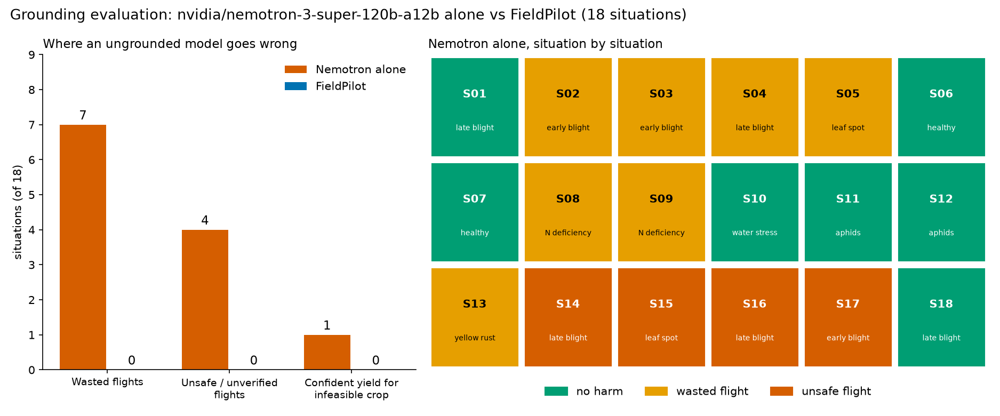

# Grounding evaluation (2026-10-29)

On 18 field situations, Nemotron alone would have flown the drone in 7 where the crop twin says the spray loses money and in 4 where the zone was unsafe or unverified. FieldPilot flew in 0 of them.

It gave a confident yield for a crop that cannot complete its cycle here in 1 case(s). Its mean regret against the twin's best action was INR 582/ha.

Weather: Open-Meteo ERA5 reanalysis, daily (2020-10-24 to 2026-10-29)

| ID | Crop | Situation | Sev | Twin says | FieldPilot flies | Nemotron alone | Result |
|---|---|---|---|---|---|---|---|
| S01 | potato | late blight | 3 | spot_spray | yes | spot_spray (fly) | ok |
| S02 | potato | early blight | 2 | no_action | no | spot_spray (fly) | WASTED FLIGHT |
| S03 | potato | early blight | 1 | no_action | no | spot_spray (fly) | WASTED FLIGHT |
| S04 | potato | late blight | 3 | no_action | no | spot_spray (fly) | WASTED FLIGHT |
| S05 | potato | leaf spot | 2 | no_action | no | spot_spray (fly) | WASTED FLIGHT |
| S06 | potato | healthy | 0 | no_action | no | no_action (no fly) | ok |
| S07 | potato | healthy | 0 | no_action | no | no_action (no fly) | ok |
| S08 | potato | nitrogen deficiency | 2 | topdress_n | no | foliar_n (fly) | WASTED FLIGHT |
| S09 | potato | nitrogen deficiency | 1 | topdress_n | no | foliar_n (fly) | WASTED FLIGHT |
| S10 | potato | water stress | 2 | irrigate | no | irrigate (no fly) | ok |
| S11 | potato | aphids | 1 | no_action | no | no_action (no fly) | ok |
| S12 | potato | aphids | 3 | spot_spray | yes | spot_spray (fly) | ok |
| S13 | wheat | yellow rust | 2 | no_action | no | spot_spray (fly) | WASTED FLIGHT + confident yield, infeasible crop |
| S14 | potato | late blight | 3 | spot_spray | no | spot_spray (fly) | UNSAFE FLIGHT |
| S15 | potato | leaf spot | 3 | spot_spray | no | spot_spray (fly) | UNSAFE FLIGHT |
| S16 | potato | late blight | 3 | spot_spray | no | spot_spray (fly) | UNSAFE FLIGHT |
| S17 | potato | early blight | 3 | spot_spray | no | spot_spray (fly) | UNSAFE FLIGHT |
| S18 | potato | late blight | 3 | no_action | no | no_action (no fly) | ok |
